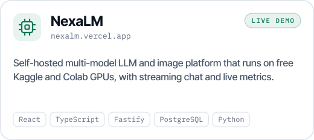
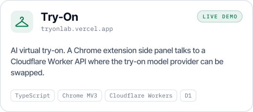
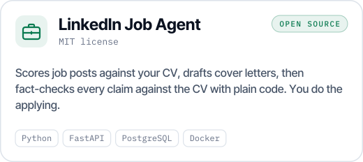
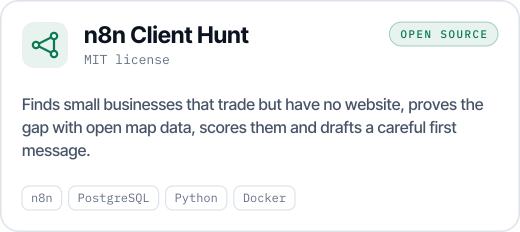
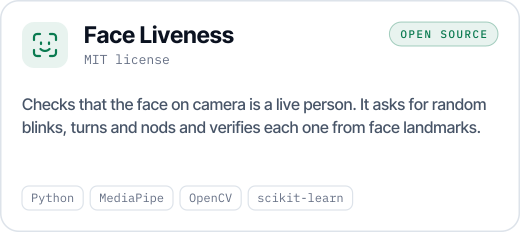
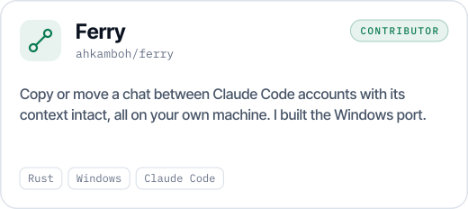
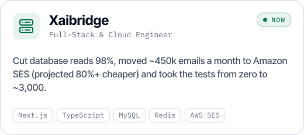
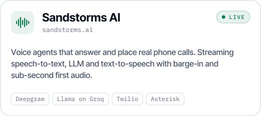
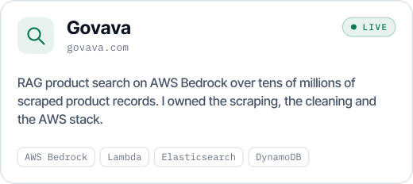
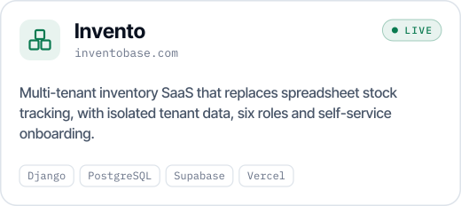

<a href="https://shakaib.vercel.app">
  <picture>
    <source media="(prefers-color-scheme: dark)" srcset="assets/header-dark.svg">
    
  </picture>
</a>

  
  
  

I build the AI part and the product around it: auth, billing, multi-tenancy, deployment, and what happens on its worst day. Right now I'm a Full-Stack & Cloud Engineer at Xaibridge in Lahore. I'm open to AI engineer and full-stack roles in Lahore, Islamabad or remote, and to freelance projects.

### Featured: Attendify

**Attendance that can't be faked.** A student holds a fingertip up to an ordinary phone camera. The app pulls the ridges out of that photo and matches them, so nobody has to buy a fingerprint scanner. The face is matched from the same camera.

- a liveness check with random challenges, so a photo or a replayed video doesn't pass
- a QR code on the classroom screen that changes every few seconds
- a GPS geofence that checks the student is near the room
- separate, isolated data for every institution

I built it alone as my final-year project, and it kept running after the grade was in.

React · TypeScript · Node.js · Express · FastAPI · InsightFace · MediaPipe · OpenCV · PostgreSQL

 

### Open source

<a href="https://github.com/shakaibarsalan/nexalm"><picture><source media="(prefers-color-scheme: dark)" srcset="assets/cards/nexalm-dark.svg"></picture></a>
<a href="https://github.com/shakaibarsalan/tryon"><picture><source media="(prefers-color-scheme: dark)" srcset="assets/cards/tryon-dark.svg"></picture></a>

<a href="https://github.com/shakaibarsalan/linkedin-job-agent"><picture><source media="(prefers-color-scheme: dark)" srcset="assets/cards/linkedin-job-agent-dark.svg"></picture></a>
<a href="https://github.com/shakaibarsalan/n8n-client-hunt"><picture><source media="(prefers-color-scheme: dark)" srcset="assets/cards/n8n-client-hunt-dark.svg"></picture></a>

<a href="https://github.com/shakaibarsalan/face-liveness-detection"><picture><source media="(prefers-color-scheme: dark)" srcset="assets/cards/face-liveness-detection-dark.svg"></picture></a>
<a href="https://github.com/ahkamboh/ferry"><picture><source media="(prefers-color-scheme: dark)" srcset="assets/cards/ferry-dark.svg"></picture></a>

Try the demos in your browser: [nexalm.vercel.app](https://nexalm.vercel.app) and [tryonlab.vercel.app](https://tryonlab.vercel.app).

### Built at work, still live

<a href="https://www.linkedin.com/in/shakaib-arsalan"><picture><source media="(prefers-color-scheme: dark)" srcset="assets/cards/xaibridge-dark.svg"></picture></a>
<a href="https://sandstorms.ai"><picture><source media="(prefers-color-scheme: dark)" srcset="assets/cards/sandstorms-dark.svg"></picture></a>

<a href="https://govava.com"><picture><source media="(prefers-color-scheme: dark)" srcset="assets/cards/govava-dark.svg"></picture></a>
<a href="https://inventobase.com"><picture><source media="(prefers-color-scheme: dark)" srcset="assets/cards/invento-dark.svg"></picture></a>

Sandstorms AI and Govava were built at FourDevs.ai, and Invento at Hello Future Technologies. Their code belongs to those companies, so it isn't here.

### Smaller projects

- **[audio-transcription-tool](https://github.com/shakaibarsalan/audio-transcription-tool)**: local Whisper transcription with an NLP quality check for creators
- **[UAVDT-Dataset-Training](https://github.com/shakaibarsalan/UAVDT-Dataset-Training)**: Faster R-CNN vehicle detection on drone footage
- **[Urdu-Text-Generation](https://github.com/shakaibarsalan/Urdu-Text-Generation)**: character- and word-level Urdu language models, LSTM vs GRU vs RNN
- **[Elevvo_ML-Internship](https://github.com/shakaibarsalan/Elevvo_ML-Internship)**: regression, clustering, imbalanced classification and a recommender

### Stack

<picture>
  <source media="(prefers-color-scheme: dark)" srcset="assets/stack-dark.svg">
  
</picture>

### On GitHub lately

<picture>
  <source media="(prefers-color-scheme: dark)" srcset="https://raw.githubusercontent.com/shakaibarsalan/shakaibarsalan/stats/stats-dark.svg">
  
</picture>

BS Computer Science, University of Management & Technology, Lahore · CGPA 3.73 / 4.00 · Rector's Award ×2 
Every image on this page is drawn by code in this repo ([scripts](scripts)), and the stats card is redrawn every day by a GitHub Action.
