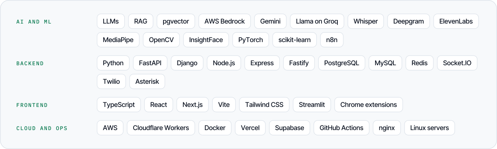

<a href="https://shakaib.vercel.app">
  <picture>
    <source media="(prefers-color-scheme: dark)" srcset="assets/header-dark.svg">
    
  </picture>
</a>

  
  
  

I build the AI part and the product around it: auth, billing, multi-tenancy and deployment. I'm a Full-Stack & Cloud Engineer at Xaibridge in Lahore, open to AI engineer and full-stack roles in Lahore, Islamabad or remote, and to freelance projects.

### Featured: Attendify

**Attendance that can't be faked.** A phone camera reads the student's fingerprint and face, so there's no scanner to buy. A liveness check, a rotating QR code and a GPS fence stop proxy attendance. I built it alone, and it's live.

 

### Open source

| | Project | What it does |
|:-:|:--|:--|
|  | **[NexaLM](https://github.com/shakaibarsalan/nexalm)** · [demo](https://nexalm.vercel.app) | Runs many LLMs on free Colab and Kaggle GPUs |
|  | **[Try-On](https://github.com/shakaibarsalan/tryon)** · [demo](https://tryonlab.vercel.app) | AI virtual try-on in a Chrome extension |
|  | **[LinkedIn Job Agent](https://github.com/shakaibarsalan/linkedin-job-agent)** | Scores jobs and fact-checks its cover letters against your CV |
|  | **[n8n Client Hunt](https://github.com/shakaibarsalan/n8n-client-hunt)** | Finds local businesses with no website and drafts outreach |
|  | **[Face Liveness](https://github.com/shakaibarsalan/face-liveness-detection)** | Stops photo and video spoofing with random face challenges |
|  | **[Ferry](https://github.com/ahkamboh/ferry)** | Moves Claude Code chats between accounts. I built the Windows port |

### Built at work

| | Product | What I did |
|:-:|:--|:--|
|  | **Xaibridge** Full-Stack & Cloud Engineer, now | Cut database reads 98% and moved ~450k emails a month to Amazon SES |
|  | **[Sandstorms AI](https://sandstorms.ai)** FourDevs.ai | Voice agents that answer and place real phone calls |
|  | **[Govava](https://govava.com)** FourDevs.ai | RAG search over tens of millions of products on AWS Bedrock |
|  | **[Invento](https://inventobase.com)** Hello Future Technologies | Multi-tenant inventory SaaS, built solo |

### Smaller projects

- **[audio-transcription-tool](https://github.com/shakaibarsalan/audio-transcription-tool)**: local Whisper transcription with an NLP quality check
- **[UAVDT-Dataset-Training](https://github.com/shakaibarsalan/UAVDT-Dataset-Training)**: Faster R-CNN vehicle detection on drone footage
- **[Urdu-Text-Generation](https://github.com/shakaibarsalan/Urdu-Text-Generation)**: Urdu language models, LSTM vs GRU vs RNN
- **[Elevvo_ML-Internship](https://github.com/shakaibarsalan/Elevvo_ML-Internship)**: regression, clustering, classification and a recommender

### Stack

<picture>
  <source media="(prefers-color-scheme: dark)" srcset="assets/stack-dark.svg">
  
</picture>

### On GitHub lately

<picture>
  <source media="(prefers-color-scheme: dark)" srcset="https://raw.githubusercontent.com/shakaibarsalan/shakaibarsalan/stats/stats-dark.svg">
  
</picture>

BS Computer Science, University of Management & Technology, Lahore · CGPA 3.73 / 4.00 · Rector's Award ×2 
Every image on this page is drawn by code in this repo ([scripts](scripts)), and the stats card is redrawn every day by a GitHub Action.
